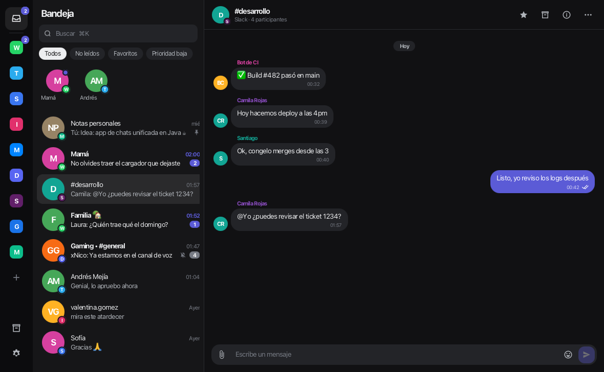

# Unichat

[Español](README.md) · English

A unified desktop inbox: **WhatsApp, Telegram, Signal, Instagram, Messenger, Discord, Slack, Google Messages, X
and LinkedIn in one app**, built with **Java 21 + JavaFX** for Windows and macOS (Linux if you build it). Inspired
by Beeper (same idea and workflow); the code is its own. The app speaks English and Spanish (Settings →
Appearance).



## Install

Download the latest version from **[Releases](https://github.com/vaoan/unichat/releases/latest)**. Java is
included.

| System | File | Built-in local server |
|---|---|---|
| Windows 10/11 (x64) | `Unichat-<version>.msi` (installer) or `Unichat-<version>-windows.zip` (portable: unzip and open `Unichat\Unichat.exe`) | Yes (not Signal yet) |
| macOS 12+ on Apple Silicon (M1 or later) | `Unichat-<version>.dmg` | Yes |
| Intel Mac, Linux | Build it (see below) | No: only with your own server ([docs/BRIDGES.md](docs/BRIDGES.md), in Spanish) |

**The first time you open it** you get a warning, because the app isn't signed with a paid certificate yet:

- **macOS** ("Apple could not verify…"): open System Settings → Privacy & Security, scroll to the Unichat notice
  and click **Open Anyway**. Only once.
- **Windows** ("Windows protected your PC"): click **More info** → **Run anyway**.

To check a file is the published one, compare it with the release's `sha256sums.txt` (`shasum -a 256 <file>` on
a Mac, `Get-FileHash <file>` on Windows).

Unichat tells you when a new version is out (turn it off in Settings → Privacy; check now in Settings → About).

## Risks of using bridges

Unichat reaches each network through the [mautrix](https://github.com/mautrix) bridges, which do what the
network's own app or website does, but **no network authorizes them**. WhatsApp, Instagram, Facebook, LinkedIn or
X may ask you to sign in again, limit your account or, rarely, suspend it. The same goes for Beeper and any
unofficial app. If an account matters for your work, think before connecting it.

What leaves your computer and where to: [docs/PRIVACIDAD.md](docs/PRIVACIDAD.md) (in Spanish). In short: no
Unichat servers, no analytics, no automatic crash reports; on Windows and Apple Silicon Macs the Matrix server and
the bridges run on your own computer, listening only on `127.0.0.1`.

## How it works

Unichat is a **Matrix** client. Each network arrives through a mautrix bridge, as in Beeper. On Windows and Apple
Silicon Macs, Unichat brings its own Matrix server (tuwunel) and installs, starts and watches it by itself,
downloading each bridge the first time you connect that network. It can also use your own server: `server/` has a
one-command Docker setup.

Want a look first? On the start screen click **Try demo mode**: sample data in memory, with simulated incoming
messages, typing and read receipts.

## Highlights

- Unified inbox with each network's badge on the avatar; pins, favourites, folders, filters per network and account.
- Several accounts per network, each with its alias and tag.
- Threads with replies, reactions, edits, rich text, photos, videos, voice notes and files; sending many files at
  once, one at a time, retried for as long as it takes.
- Voice notes to text with Whisper, on your computer.
- Optional AI drafts and proofreading through your own Claude Code or Codex (off by default).
- Live account status: a bar says when a network stops working, and the local server restarts a stuck bridge.
- ⌘K / Ctrl+K to jump to any chat or run a command.
- Accessibility: text from 85 % to 160 %, high contrast, reduced motion, screen readers (Narrator, VoiceOver, Orca),
  everything usable with the keyboard (F6 between areas).

## Build

Requirement: **JDK 21+** (Maven comes with the wrapper).

```bash
./run-dev.sh            # macOS / Linux: run from source
./mvnw verify           # tests and checks
./package.sh            # macOS: release/Unichat.app + .dmg · Linux: app-image (+ .deb)
```

```powershell
.\mvnw.cmd javafx:run   # Windows: run from source
.\package.ps1           # Windows: release\Unichat\Unichat.exe + zip (+ .msi with WiX 3)
```

To publish a version: change `<version>` in `pom.xml`, commit, and push the tag `v<version>`; the `build` workflow
creates the release with the packages and `sha256sums.txt`. The local server and the Windows bridges are built by
the `natives` workflow ([docs/SERVIDOR-NATIVO.md](docs/SERVIDOR-NATIVO.md)).

## License

Unichat's own code is [0BSD](LICENSE). Third-party parts keep their licenses; the full list with license texts is
in [THIRD-PARTY.md](THIRD-PARTY.md). The mautrix bridges (AGPL-3.0) aren't inside the app: they're downloaded
when you connect each network, from their official releases or, on Windows, from this repository's `natives-*`
release, built from each version's source (linked there).

---

Not affiliated with Beeper or Automattic. Each network's trademarks belong to their owners.
