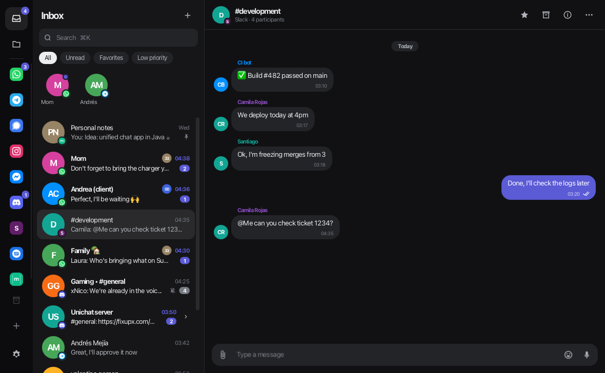
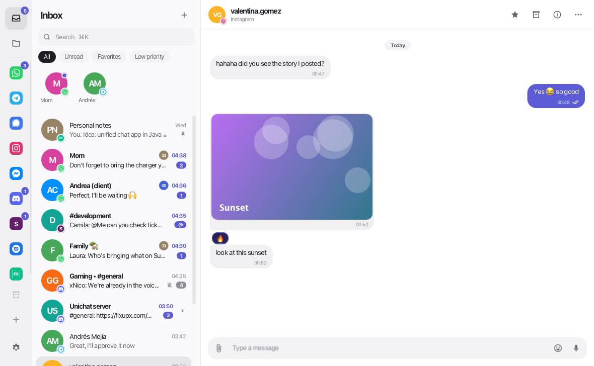
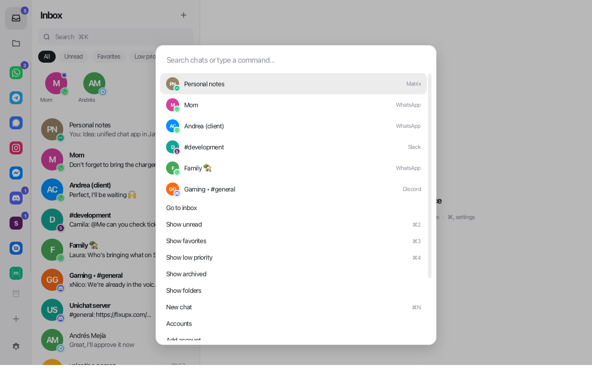
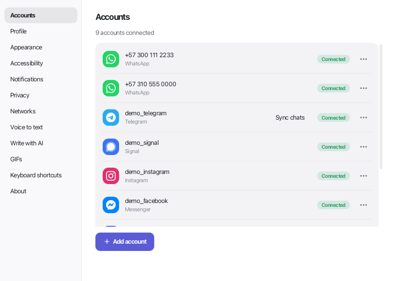

# Unichat

English · [Español](README.es.md)

A unified message inbox for the desktop — **WhatsApp, Telegram, Signal, Instagram, Messenger,
Discord, Slack, Google Messages, X and LinkedIn in one app** — built with **Java 25 + JavaFX** for
Windows and macOS (Linux, if you build it). Inspired by Beeper (same idea and workflow); the code is its own.
The app speaks English and Spanish, following your system (Settings → Appearance to choose).



| Light | Command palette | Accounts |
|---|---|---|
|  |  |  |

## Install

Download the latest version from **[Releases](https://github.com/vaoan/unichat/releases/latest)**. It doesn't need Java:
Java comes inside.

| System | File | Built-in local server |
|---|---|---|
| Windows 10/11 (x64) | `Unichat-<version>.msi` (installer) or `Unichat-<version>-windows.zip` (portable: unzip it and open `Unichat\Unichat.exe`) | Yes (not Signal yet) |
| macOS 13.3+ (Ventura) on Apple Silicon (M1 or later) | `Unichat-<version>.dmg` | Yes |
| Intel Mac, Linux | Build it (see [Build](#build)) | No: only with your own server ([docs/BRIDGES.md](docs/BRIDGES.md)) |

**The first time you open it** a warning appears, because the app isn't signed with a paid certificate yet:

- **macOS** ("cannot be opened because Apple cannot check it…"): open System Settings → Privacy &
  Security, scroll down to the Unichat notice and click **Open Anyway**. It's only asked once.
- **Windows** ("Windows protected your PC"): click **More info** → **Run anyway**.

To check that the file is the published one, compare it with `sha256sums.txt` from the same release
(`shasum -a 256 <file>` on a Mac, `Get-FileHash <file>` on Windows).

Unichat tells you when there's a new version (Settings → Privacy to turn it off; Settings → About to check
now).

## Risks of using bridges

Unichat connects to each network with the [mautrix](https://github.com/mautrix) bridges, which do the same as the
network's official app or website, but **no network authorizes them**. WhatsApp, Instagram, Facebook, LinkedIn or X
may ask you to sign in again, limit your account or, in rare cases, suspend it. The same happens with
Beeper and with any unofficial app. If an account is important for your work, think about it before connecting it.

What leaves your computer and where to: [docs/PRIVACY.md](docs/PRIVACY.md).

## How it works

Unichat is a **Matrix** client. Each network arrives through a [mautrix](https://github.com/mautrix) *bridge*
(as Beeper used to do). On Windows and on Apple Silicon Macs, Unichat brings its own Matrix server and
installs, starts and watches it without you doing anything: it downloads each bridge the first time you connect that network
([docs/NATIVE-SERVER.md](docs/NATIVE-SERVER.md)). It can also use a server of your own: `server/` has everything
to set one up with Docker in one command ([docs/BRIDGES.md](docs/BRIDGES.md)).

Just want to see it? On the start screen click **Try demo mode**: sample data in
memory, with simulated incoming messages, "typing…" and read receipts.

## Features

- **Unified inbox** with a network badge on each avatar, pinned chats on top, favorites in a grid.
- Filters: All · Unread · Favorites · Low priority · Archived · by network (the sidebar shows
  only the networks you have connected).
- **Threads** with grouped bubbles, day separators, replies, reactions, editing, deleting,
  large emojis, links, **bold**/*italic*/`code`, images, files, video and audio.
- **Account status, clear and live**: if a network stops working, a strip above the list says so.
  Red with "Link" if the session was closed; amber while Unichat recovers it by itself. In the sidebar
  the network is marked. With the local server, Unichat restarts on its own a bridge that doesn't respond, that has been
  disconnected for 10 minutes or that disconnects again and again.
- **Telegram with your own keys**: Telegram requires each person to get an `api_id` and `api_hash` for free at
  my.telegram.org. Unichat asks for them, with the steps, when you connect Telegram; they're changed in Settings → Networks.
- **Servers** (Discord, Telegram forums): a channel's header shows its server; a click opens the list
  of channels. When you open a notification from a channel, the list shows its server with the channel marked.
- **Favorites**: right-click (or the menu key) on an emoji, sticker or GIF, in the chat or in the side panel,
  to add it to or remove it from favorites or recents. The panel's **Favorites** tab gathers them all.
- **Stickers between networks**: Telegram's sticker sets in the side panel (yours, and any opened from a sticker's
  menu). A sticker goes to any network in a format it takes: an animated GIF reaches Telegram as an animated sticker (an
  animated WebP, WhatsApp's, arrives still).
- **Write with AI**: in Settings → Write with AI you can turn on two buttons that use Claude Code or Codex, if you have
  either installed. One writes a draft following your instructions, with the chat as context; when you click it, that chat
  goes to that program's service. The other corrects the spelling, accents and wording of what you wrote, changing
  as little as possible; it only sends that text. The result stays in the text box for you to review: it's never sent by itself.
  With "Learn how I write", drafts follow your style and learn from what you change in them; Settings shows what was
  learned and lets you undo it.
- **Voice notes to text**: "Transcribe" under each audio (or the T key). It uses Whisper, which comes with Unichat and
  runs on your computer, free and without sending the audio to any service; the model (60 or 190 MB) is downloaded
  the first time. In Settings → Voice to text you can choose the model and language, or set your own command
  (`{archivo}`, `{idioma}`). Claude Code and Codex don't work for this: they don't take audio.
- **Media on demand**: photos, videos and files are downloaded only when you open them; what's downloaded takes up at
  most what you choose in Settings → Privacy (1 GB by default).
- Delivery states (sending → sent → delivered → read) and a "typing…" indicator.
- **Scrolling that stays put**: the chat follows new messages only while you're at its end ("● Up to date" at the bottom
  right). Scrolled up, nothing moves it, not even writing or sending; the ↓ button says how many arrived meanwhile.
- **WhatsApp Business** messages show their buttons (pay an order, open a link) as chips. They're pressed in WhatsApp
  on your phone: the bridge can't pass a press on.
- Composer: Enter sends (configurable), attach or drag files, emoji picker,
  ↑ edits your last message, drafts per chat. The clip offers file, **photos or videos** (sent as a photo even if they're
  WebP or 24 MP: Unichat turns them into a 2560 px JPEG, as the official apps do; otherwise Telegram sends them as a
  file), document (the original, uncompressed), **many files** or **many photos** (as photos): they go one by one, in order, with a bar on top (like the audio one) that says
  which one is going, to which chat, how much is left, and shows the photo; what's left can be cancelled.
  **Formatting** (*bold*, _italic_, ~strike~, `code`, quotes) as each network shows it, also from the box's right-click
  menu or ⌘B ⌘U ⌘⇧X; paste a copied picture or files to send them.
- **Photos protected from AI** (clip → "Photo protected from AI…"): Mist's method, run on your computer, changes the
  photo almost invisibly so an AI that trains on it or edits it sees a pattern instead. Three levels (about 3, 8 or 25
  minutes); it's sent as a PNG at its own size, up to 4096 px. The first time it downloads what it needs (~330 MB on a
  Mac, ~500 MB on Windows). Macs with Apple chips and 64-bit Windows. No protection of this kind is certain: a strong
  re-compression can undo part of it.
- **Save what they send**: in a chat's options (the gear in its profile), photos, videos, audio, documents, GIFs and the
  videos behind links are saved as they arrive, even with the chat closed, in a folder per chat; its past can be saved
  too. "Save link" in a message's menu saves one on demand. Links go through yt-dlp (and gallery-dl if you have it).
- **Your own cloud**: Settings → Cloud keeps your settings, chat options, what the AI learned and the saved files in
  your pCloud, Dropbox or WebDAV storage (Icedrive, Nextcloud…), the same on every computer.
- Chat actions: mark read/unread, favorite, pin, mute, low priority, archive,
  **reminders** (1 h, 3 h, tomorrow, Monday), leave.
- Info panel: participants, shared media, description.
- **Settings → Accounts** (also with the + button on the sidebar): all your accounts, one per row; **Add account** → you choose the network
  → a wizard with instructions, the large QR code or the field to paste cookies/codes. You can connect
  several accounts of each network (e.g. personal and work WhatsApp), with an alias, a tag on each chat, a filter
  by account and disconnecting each one separately.
- **⌘K / Ctrl+K**: jump to any chat or run commands.
- Desktop notifications and a counter in the system tray / Dock; it stays in the background when closed.
- Settings: light/dark/system theme, accent color, font size, compact list,
  notifications, privacy (read receipts, "typing"), shortcuts.

## Accessibility

In **Settings → Accessibility**:

- **Text size** from 85 % to 160 % (also with Ctrl/⌘ + / − / 0).
- **High contrast** (follows Windows' high contrast mode or macOS's "Increase contrast", or can be forced):
  solid colors, strong borders, outlined bubbles and an accent color darkened until it meets WCAG AA (4.5:1).
- **Reduce motion** (follows Windows' "Show animations" / macOS's "Reduce motion").
- **More readable font** (Verdana), **more line spacing**, **stronger focus indicator**.
- **Message actions always visible** (without depending on the mouse).
- **Read new messages aloud** with the system voice.

Screen readers (Narrator, VoiceOver, Orca): chats, messages, icon-only buttons, images,
reactions and switches have a spoken description.

Everything can be used **with the keyboard alone**: F6 / Shift+F6 jumps between sidebar, list, messages and text
box; in the messages, ↑/↓ moves through them, **R** replies, **E** edits, **Enter** opens the actions, **1–6** reacts,
**Esc** goes back to the text box. The focus is visible when navigating with Tab.

## Build

Requirement: **JDK 25+** (Maven isn't needed, the wrapper is used).

```bash
./run-dev.sh            # macOS / Linux: run from source
./mvnw test             # tests
./package.sh            # macOS: release/Unichat.app + .dmg · Linux: app-image (+ .deb)
```

Every push to `main` builds the packages in GitHub Actions (artifacts `unichat-windows` and `unichat-macos` of the run).
To publish a version: change `<version>` in `pom.xml`, commit, and push the tag `v<version>`
(`git tag v1.1.0 && git push origin v1.1.0`); the `build` workflow creates the release with the packages and
`sha256sums.txt`. A tag with a suffix (`v1.1.0-beta.1`) comes out as a pre-release and the app doesn't offer it as an update.
The server and the Windows bridges are built separately by the `natives` workflow (see
[docs/NATIVE-SERVER.md](docs/NATIVE-SERVER.md#own-builds)).

```powershell
.\mvnw.cmd javafx:run   # Windows: run from source
.\package.ps1           # Windows: release\Unichat\Unichat.exe + zip (+ .msi with WiX 3)
```

Keyboard and screen reader test with the real UI (needs a display):

```bash
./mvnw test -Dtest=KeyboardUiTest -Dunichat.uiTests=true
```

Integration test against a real server (users `alice` and `bob`, password `pass1234`):

```bash
UNICHAT_IT_HOMESERVER=http://localhost:8008 ./mvnw test -Dtest=MatrixLiveIT
```

## Shortcuts

| Shortcut | Action |
|---|---|
| ⌘K / Ctrl+K | Search chats and commands |
| F6 / Shift+F6 | Next / previous area (sidebar, list, messages, text) |
| ⌘+ ⌘− ⌘0 / Ctrl+ Ctrl− Ctrl+0 | Text size |
| Alt+↑ / Alt+↓ | Previous / next chat (with Shift: unread only) |
| ⌘E / Ctrl+E | Archive / unarchive |
| ⌘⇧U / Ctrl+Shift+U | Mark read / unread |
| ⌘1…4 / Ctrl+1…4 | All · Unread · Favorites · Low priority |
| ⌘⇧I / Ctrl+Shift+I | Info panel |
| ⌘I / Ctrl+I | AI draft |
| ⌘O / Ctrl+O | Correct spelling and wording with AI |
| ⌘, / Ctrl+, | Settings |

## Local data

Settings and session in `%APPDATA%\Unichat` (Windows), `~/Library/Application Support/Unichat` (macOS) or
`~/.config/unichat` (Linux). The access token is stored in plain text in `session.properties`, which isn't copied between computers. To
take your data to another computer copy `settings.properties`, `preferences.json` (archived, muted, favorites and
folders), `media-library.json` with `media-library/` (your favourite stickers and GIFs) and `writing-style.md` (what the AI
learned of how you write); with Settings → Cloud this happens by itself. In the same place:
`cache/media` (photos and videos you've seen, with a limit), `models/` (voice model), `transcripts/` (transcriptions),
`tools/` (ffmpeg, yt-dlp, what protecting photos needs) and `logs/`.
If you go back to an older version of Unichat it will ask you to sign in again, because the session moved to
`session.properties`; nothing is lost.

## Known limitations

- No Matrix end-to-end encryption: set up the bridges without encryption (`setup` already does).
- What a bridge can't pass on stays on the phone, like WhatsApp Business buttons: Unichat shows them, the network's app
  presses them.

## Code signing policy

Free code signing provided by [SignPath.io](https://about.signpath.io), certificate by [SignPath Foundation](https://signpath.org).

The application to SignPath Foundation is in progress: until it's approved, the Windows installers are unsigned
(see [Install](#install)). Once approved, only what GitHub Actions builds from this repository
(`.github/workflows/build.yml`) is signed, and each release is signed after an approver's manual approval.

- Committers and reviewers: [vaoan](https://github.com/vaoan)
- Approvers: [vaoan](https://github.com/vaoan)

Privacy: Unichat sends nothing to its authors. What leaves your computer, where to and how to turn it off is in
[docs/PRIVACY.md](docs/PRIVACY.md), and the Windows installer shows it before installing.

## License

Unichat's code is [0BSD](LICENSE): use it, copy it, modify it and distribute it as you like, with no need to
give credit. That covers only this code. Third-party parts keep their own licenses: JavaFX
(GPLv2 with the Classpath Exception), the Java libraries (Apache 2.0 and BSD), whisper.cpp (MIT), libwebp (BSD), tuwunel
and libolm (Apache 2.0). The mautrix bridges (AGPL-3.0) don't come in the app: they're downloaded separately when you connect each network,
from their official releases or, on Windows, from this repository's `natives-*` release, built unchanged from
each version's source (linked in that release).
The full list, with the license texts, is in [THIRD-PARTY.md](THIRD-PARTY.md), which also goes inside the packages.

---

Not affiliated with Beeper or Automattic. Each network's trademarks belong to their owners.
