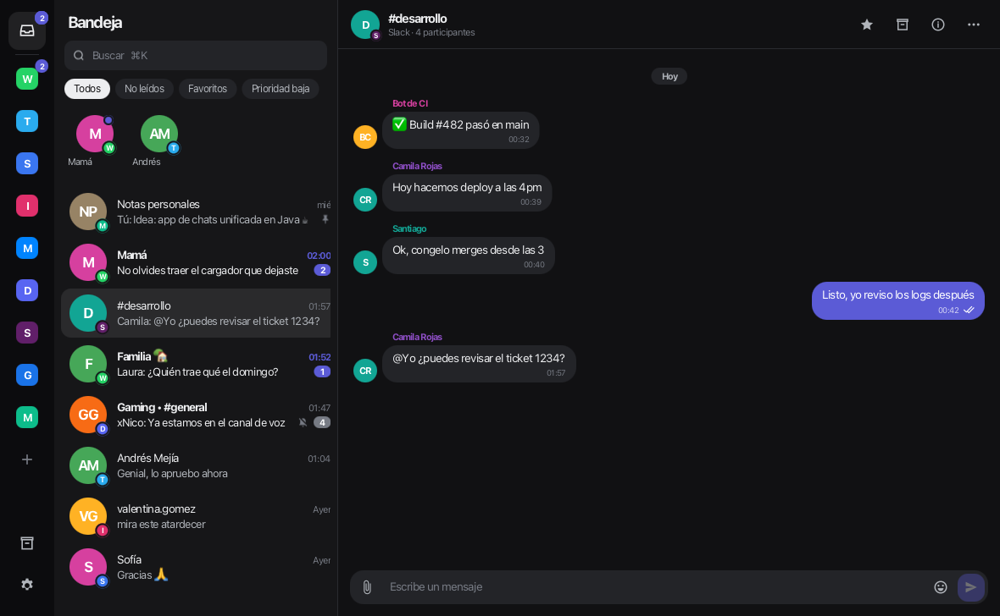
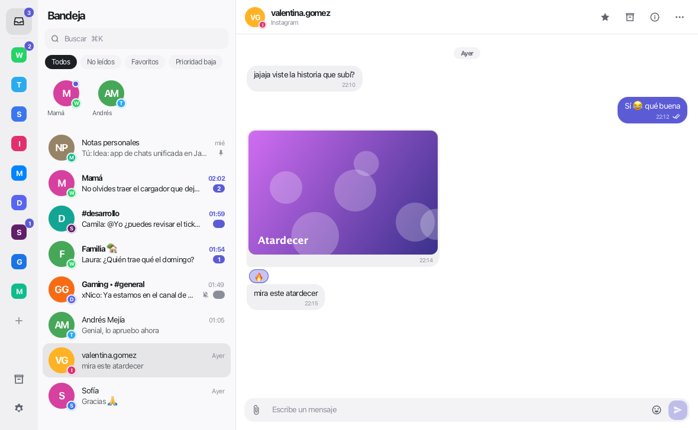
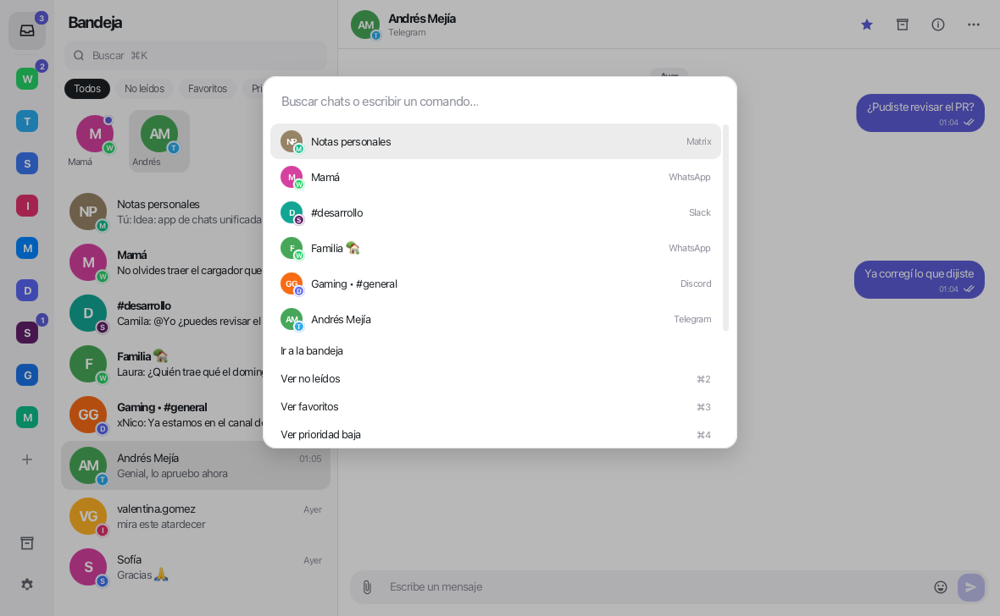
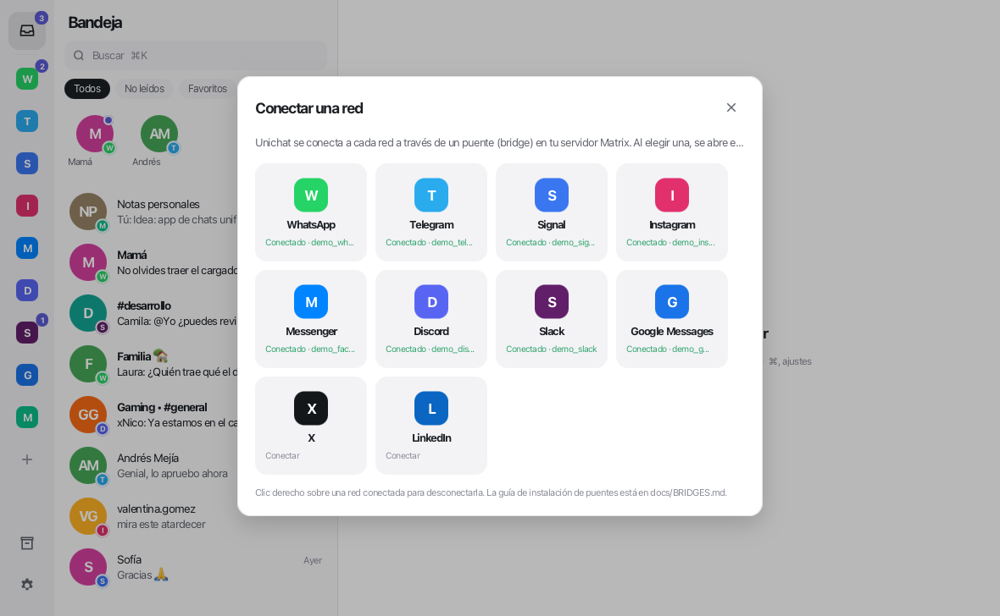

# Unichat

Bandeja de mensajes unificada para escritorio — **WhatsApp, Telegram, Signal, Instagram, Messenger,
Discord, Slack, Google Messages, X y LinkedIn en una sola app** — hecha en **Java 21 + JavaFX** para
Windows, macOS y Linux. Inspirada en Beeper (misma idea y flujo de trabajo); el código es propio.



| Claro | Paleta de comandos | Conectar una red |
|---|---|---|
|  |  |  |

## Cómo funciona

Unichat es un cliente **Matrix**. Cada red llega mediante un *bridge* [mautrix](https://github.com/mautrix)
instalado en tu propio servidor Matrix (igual que hacía Beeper). En `server/` está todo para montarlo con
Docker en un comando — ver **[docs/BRIDGES.md](docs/BRIDGES.md)**.

¿Solo quieres verla? En la pantalla de inicio pulsa **Probar el modo demo**: datos de ejemplo en
memoria, con mensajes entrantes, "escribiendo…" y confirmaciones de lectura simulados.

## Funciones

- **Bandeja unificada** con insignia de red en cada avatar, fijados arriba, favoritos en cuadrícula.
- Filtros: Todos · No leídos · Favoritos · Prioridad baja · Archivados · por red (barra lateral).
- **Hilos** con burbujas agrupadas, separadores de día, respuestas, reacciones, edición, borrado,
  emojis grandes, enlaces, **negrita**/*cursiva*/`código`, imágenes, archivos, video y audio.
- Estados de entrega (enviando → enviado → entregado → leído) e indicador de "escribiendo…".
- Compositor: Enter envía (configurable), adjuntar o arrastrar archivos, selector de emojis,
  ↑ edita tu último mensaje, borradores por chat.
- Acciones por chat: marcar leído/no leído, favorito, fijar, silenciar, prioridad baja, archivar,
  **recordatorios** (1 h, 3 h, mañana, el lunes), salir.
- Panel de información: participantes, multimedia compartida, descripción.
- **⌘K / Ctrl+K**: saltar a cualquier chat o ejecutar comandos.
- Notificaciones de escritorio y contador en la bandeja del sistema / dock; se queda en segundo plano al cerrar.
- Ajustes: tema claro/oscuro/sistema, color de acento, tamaño de letra, lista compacta,
  notificaciones, privacidad (confirmaciones de lectura, "escribiendo"), atajos.

## Accesibilidad

En **Ajustes → Accesibilidad**:

- **Tamaño de texto** de 85 % a 160 % (también con Ctrl/⌘ + / − / 0).
- **Alto contraste** (sigue el modo de alto contraste de Windows o «Aumentar contraste» de macOS, o se fuerza):
  colores sólidos, bordes marcados, burbujas delimitadas y color de acento oscurecido hasta cumplir WCAG AA (4.5:1).
- **Reducir movimiento** (sigue «Mostrar animaciones» de Windows / «Reducir movimiento» de macOS).
- **Fuente más legible** (Verdana), **más interlineado**, **indicador de foco reforzado**.
- **Acciones de mensaje siempre visibles** (sin depender del ratón).
- **Leer mensajes nuevos en voz alta** con la voz del sistema.

Lectores de pantalla (Narrador, VoiceOver, Orca): chats, mensajes, botones de solo ícono, imágenes,
reacciones e interruptores tienen descripción hablada.

Todo se puede usar **solo con teclado**: F6 / Shift+F6 salta entre barra lateral, lista, mensajes y campo de
texto; en los mensajes, ↑/↓ recorre, **R** responde, **E** edita, **Enter** abre las acciones, **1–6** reacciona,
**Esc** vuelve al campo de texto. El foco se ve al navegar con Tab.

## Descargar para Windows

Cada push a `main` compila la app en GitHub Actions. En la pestaña **Actions** → último run →
artefacto **unichat-windows** encontrarás:

- `Unichat-1.0.0-windows.zip` — portable: descomprime y abre `Unichat\Unichat.exe` (no necesita Java).
- `Unichat-1.0.0.msi` — instalador (cuando WiX está disponible en el runner).

## Compilar

Requisito: **JDK 21+** (Maven no hace falta, se usa el wrapper).

```bash
./run-dev.sh            # macOS / Linux: ejecutar desde el código
./mvnw test             # tests
./package.sh            # macOS: release/Unichat.app + .dmg · Linux: app-image (+ .deb)
```

```powershell
.\mvnw.cmd javafx:run   # Windows: ejecutar desde el código
.\package.ps1           # Windows: release\Unichat\Unichat.exe + zip (+ .msi con WiX 3)
```

Prueba de teclado y lector de pantalla con la UI real (necesita pantalla):

```bash
./mvnw test -Dtest=KeyboardUiTest -Dunichat.uiTests=true
```

Prueba de integración contra un servidor real (usuarios `alice` y `bob`, contraseña `pass1234`):

```bash
UNICHAT_IT_HOMESERVER=http://localhost:8008 ./mvnw test -Dtest=MatrixLiveIT
```

## Atajos

| Atajo | Acción |
|---|---|
| ⌘K / Ctrl+K | Buscar chats y comandos |
| F6 / Shift+F6 | Siguiente / anterior zona (barra, lista, mensajes, texto) |
| ⌘+ ⌘− ⌘0 / Ctrl+ Ctrl− Ctrl+0 | Tamaño de texto |
| Alt+↑ / Alt+↓ | Chat anterior / siguiente (con Shift: solo no leídos) |
| ⌘E / Ctrl+E | Archivar / desarchivar |
| ⌘⇧U / Ctrl+Shift+U | Marcar leído / no leído |
| ⌘1…4 / Ctrl+1…4 | Todos · No leídos · Favoritos · Prioridad baja |
| ⌘I / Ctrl+I | Panel de información |
| ⌘, / Ctrl+, | Ajustes |

## Datos locales

Ajustes y sesión en `%APPDATA%\Unichat` (Windows), `~/Library/Application Support/Unichat` (macOS) o
`~/.config/unichat` (Linux). El token de acceso se guarda en texto plano en `settings.properties`.

## Limitaciones conocidas

- Sin cifrado de extremo a extremo de Matrix: configura los bridges sin cifrado (el `setup` ya lo hace).
- El estado de cada cuenta conectada es aproximado (se deduce de los mensajes del bot del bridge).
- Cada arranque hace una sincronización inicial completa.

---

No afiliado a Beeper ni a Automattic. Las marcas de cada red pertenecen a sus dueños.
